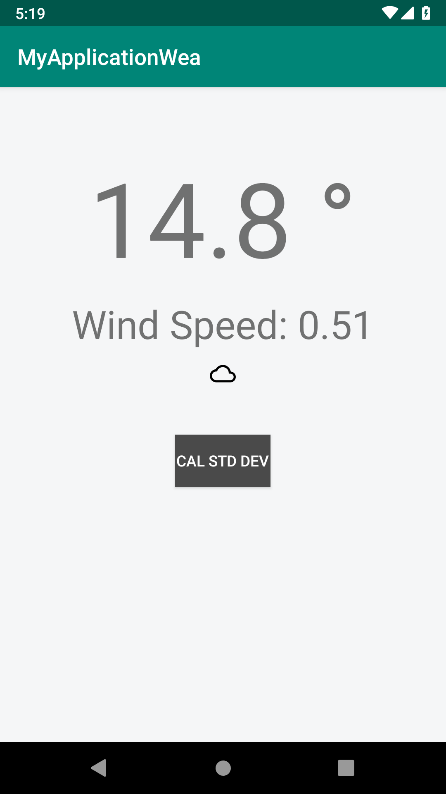

# WeatherApp

An Android weather application built with Java that displays current weather conditions and a 5-day forecast, including statistical analysis of temperature variation.

## Demo

https://github.com/rahejasudhir/WeatherApp/raw/master/screenshots/demo.mp4

## Screenshots

| Current Weather | Temperature Std Dev |
|---|---|
|  |  |

## Features

- Current weather conditions
- 5-day weather forecast
- Standard deviation calculation across forecast temperatures
- Error state handling

## Architecture

MVVM using Android Architecture Components:

- **View** — `WeatherActivity` observes LiveData and renders UI
- **ViewModel** — `WeatherViewModel` fetches data and exposes `LiveData` streams
- **Repository** — `WeatherRepository` abstracts data source access
- **API** — `WeatherApiService` (Retrofit) fetches current and forecast JSON

RxJava `Observable.zip` is used to fetch all 5 forecast days concurrently before computing the standard deviation.

## Tech Stack

| Layer | Library |
|---|---|
| Networking | Retrofit 2 + OkHttp 3 + Gson |
| Reactive | RxJava 2 + RxAndroid |
| DI | Dagger 2 |
| Lifecycle | Android Architecture Components (LiveData, ViewModel) |
| UI | Data Binding |
| Testing | JUnit 4, OkHttp MockWebServer, arch core-testing |

## Requirements

- Android SDK 28
- Min SDK 16
- Java 8

## Getting Started

1. Clone the repo:
   ```bash
   git clone https://github.com/rahejasudhir/WeatherApp.git
   ```
2. Open in Android Studio.
3. Build and run on an emulator or device (API 16+).

## Project Structure

```
app/src/main/java/com/an/trailers/
├── data/
│   ├── remote/
│   │   ├── api/         # Retrofit service interface
│   │   └── model/       # Response models
│   └── repository/      # Repository pattern
├── di/                  # Dagger components and modules
├── schedulers/          # RxJava scheduler abstraction
├── ui/
│   ├── base/            # BaseActivity
│   └── weather/         # WeatherActivity + WeatherViewModel
└── factory/             # ViewModelFactory
```

## Running Tests

```bash
./gradlew test
```
